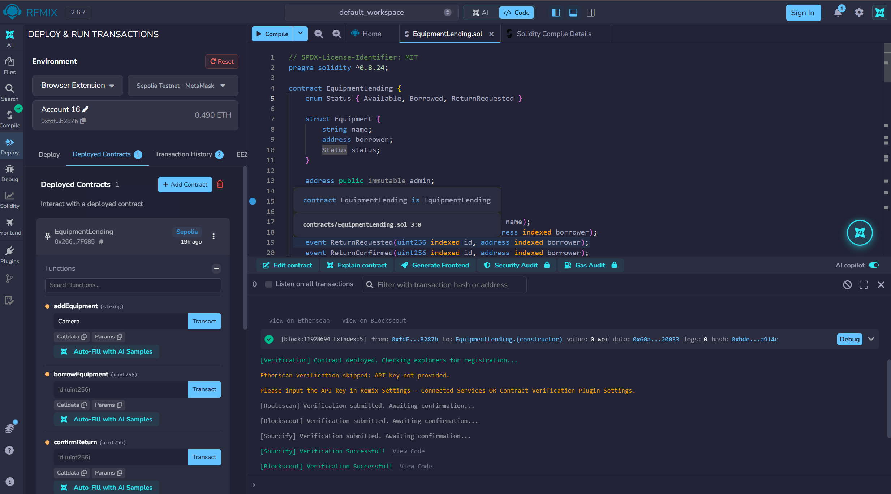
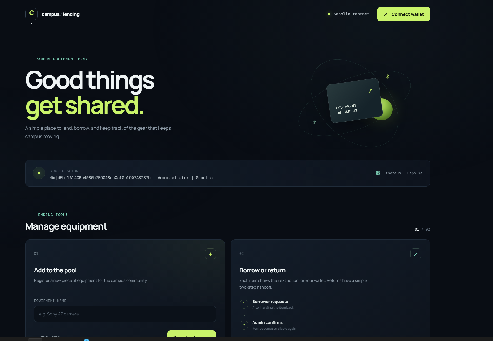
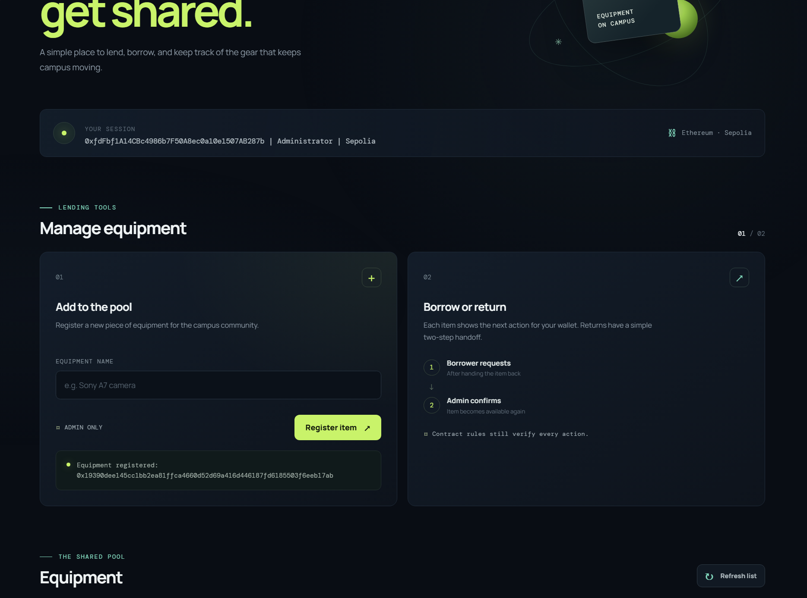
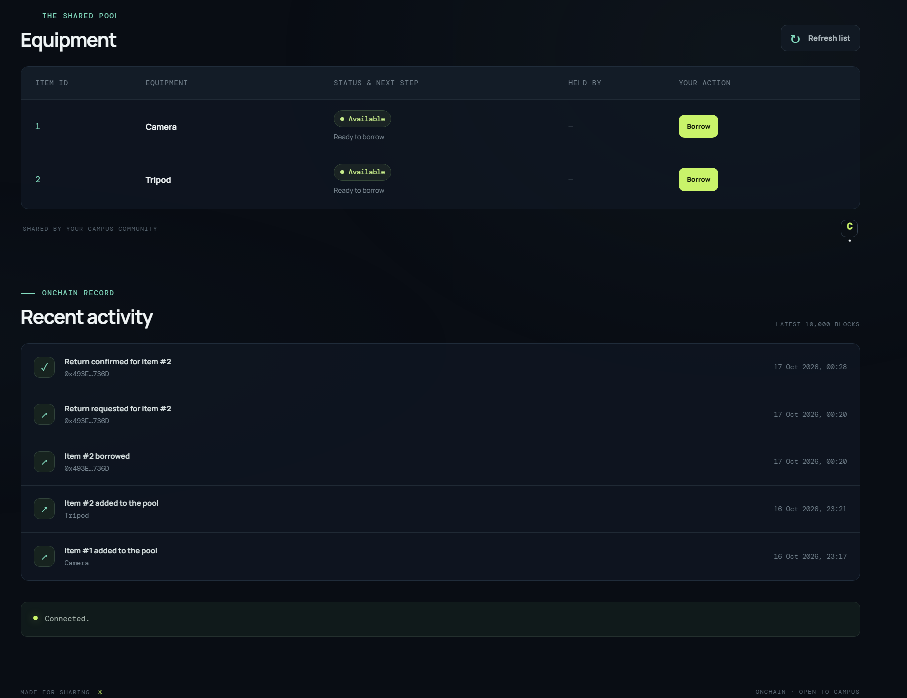

# Campus Equipment Lending DApp

**Course:** Blockchain Technology (CSE4444), Assignment 2  
**Author:** Prachet Sen Sarma (230905292)

A decentralized campus equipment lending app built with Solidity on the Ethereum Sepolia testnet. The administrator registers equipment, students borrow available items, and borrowers request returns. The administrator confirms a return, making the equipment available to borrow again.

---

## 1. Problem Statement

Campus equipment is often lent through informal records, making it difficult to know who has an item and whether it has been returned. This DApp records the equipment lending cycle on Ethereum:

1. The administrator registers an equipment item.
2. A student borrows an available item. The contract records the borrower.
3. The borrower requests a return when they bring the item back.
4. The administrator confirms the return. The item becomes available and the borrower field is cleared.

The contract enforces who can perform each action and rejects invalid state transitions.

## 2. Tech Stack

| Component | Technology |
|---|---|
| Smart contract | Solidity ^0.8.24 |
| Compile / deploy | Remix IDE + MetaMask (Browser Extension) |
| Network | Sepolia Testnet (chain ID 11155111) |
| Frontend | HTML, CSS, JavaScript |
| Wallet / blockchain library | MetaMask + Ethers.js 6.7.0 |
| Local contract tests | Hardhat |

## 3. Deployment Details

| Item | Value |
|---|---|
| Network | Sepolia Testnet (chain ID 11155111) |
| Contract address | `0x266698a18e1C9Ec9476009D8f7E5DB96d9e7F685` |
| Deployer / admin address | Read from the deployed contract using `admin()` |
| Deployment tx hash | 0x87aff5bd925f2a43446238f3d03fdfb6766381a326d7a7275bbfe0ebbaae9203 |
| Compiler | Solidity 0.8.24-compatible compiler |

View on [Sepolia Etherscan](https://sepolia.etherscan.io/address/0x266698a18e1C9Ec9476009D8f7E5DB96d9e7F685).

## 4. Project Structure

```text
campus-lending-dapp/
├── contracts/EquipmentLending.sol
├── frontend/
│   ├── index.html
│   │   ├── style.css
│   ├── app.js
│   └── abi.json
├── evidence/README.md
├── tests/EquipmentLending.test.cjs
├── test-results/test-cases.md
├── deployment/deployment-details.md
├── .gitignore
├── hardhat.config.cjs
├── package.json
└── README.md
```

## 5. Smart Contract Features

- **Constructor** sets the administrator to the deploying wallet.
- **State variables:** `admin`, `count`, and a mapping of equipment records (`name`, `borrower`, and `status`).
- **Enum** `Status { Available, Borrowed, ReturnRequested }`.
- **Functions:** `addEquipment`, `borrowEquipment`, `requestReturn`, `confirmReturn`, and `getItem`.
- **Validation (`require`):** equipment names must contain 1–80 bytes; IDs must refer to existing equipment; equipment must be available to borrow; only the borrower can request a return; only the administrator can register equipment or confirm returns; return confirmation requires a pending return request.
- **Access control:** `onlyAdmin` and `validItem` modifiers, plus a borrower address check.
- **Events** record equipment registration, borrowing, return requests, and return confirmations.
- **Return cycle:** after administrator confirmation, the borrower is cleared and the equipment status returns to `Available`.

## 6. How to Run the Application

1. Clone this repository and install Node.js, npm, Python 3, and MetaMask.
2. In `frontend/app.js`, confirm `ADDRESS` matches the deployed contract address in Section 3. Confirm `frontend/abi.json` is the ABI for that same deployment.
3. From the repository root, install dependencies and optionally compile and run the local contract tests:
   ```powershell
   npm ci
   npm run compile
   npm test
   ```
4. Start a local HTTP server from the frontend folder:
   ```powershell
   cd frontend
   py -m http.server 8000
   ```
   If `py` is unavailable, use `python -m http.server 8000`.
5. Open **http://localhost:8000** in a browser with MetaMask installed. Keep the server running while using the app. Do not open `index.html` directly as a `file://` URL.

The frontend loads Ethers.js 6.7.0 from cdnjs, so an internet connection is required when the page loads.

## 7. Connect MetaMask and Interact

1. In MetaMask, enable test networks if needed, switch to **Sepolia**, and obtain Sepolia test ETH for transaction gas.
2. On the page, click **Connect MetaMask** and approve the connection. The interface reads the account, network, administrator, item count, equipment state, and recent contract activity.
3. **Register equipment:** connect the administrator wallet, enter an equipment name, click **Add Equipment**, and approve the transaction in MetaMask.
4. **Borrow equipment:** connect a student wallet and borrow an item marked **Available**.
5. **Request a return:** using the same wallet that borrowed the item, submit a return request.
6. **Confirm the return:** connect the administrator wallet and confirm the pending return. The item becomes available again.

Each write prompts MetaMask for approval and requires Sepolia test ETH for gas. The frontend displays actions based on the connected wallet, while the contract independently enforces permissions and state rules. If the page reports a network mismatch, switch the wallet connected to `localhost:8000` to Sepolia and refresh.

---

## 8. Test Cases and Results

The automated tests use local Hardhat accounts: the deploying account acts as administrator, with separate student accounts used as borrowers and unauthorized callers.

| # | Type | Account | Action | Expected | Observed |
|---|---|---|---|---|---|
| 1 | Valid | Deployer/admin | Deploy and read initial state | Deployer is admin; count is zero | Passed |
| 2 | Valid | Admin | Add `Campus camera` and read item 1 | Count increments; item is available with no borrower | Passed |
| 3 | Invalid | Admin | Add empty and 81-byte names | Both calls revert on name validation | Passed |
| 4 | Unauthorized | Student | Add equipment | Reverts with `Admin only` | Passed |
| 5 | Invalid | Student / reader | Borrow ID 1 before an item exists; read ID 0 | Both revert with `Invalid equipment ID` | Passed |
| 6 | Valid | Student | Borrow available item 1 | Borrower is recorded; status becomes `Borrowed` | Passed |
| 7 | Invalid | Second student | Borrow item 1 while it is borrowed | Reverts with `Equipment unavailable` | Passed |
| 8 | Unauthorized + valid | Second student, then borrower | Wrong student requests return; actual borrower requests return | Wrong caller reverts; borrower succeeds | Passed |
| 9 | Invalid state | Current borrower | Request return again after a request is pending | Reverts with `Not awaiting return request` | Passed |
| 10 | Unauthorized + invalid state | Student, then admin | Student confirms; admin confirms before return request | Reverts with `Admin only`, then `Return not requested` | Passed |
| 11 | Valid | Admin | Confirm after borrower requests return | Status returns to `Available`; borrower is cleared | Passed |

Run the automated suite using `npm test`. The recorded run passed all 11 tests against Hardhat's local in-process EVM. These tests do not submit transactions to Sepolia. See [`test-results/test-cases.md`](test-results/test-cases.md) for details.

---

## 9. Screenshots

### 9.1 Smart Contract Deployment
<!-- Screenshot: Remix deployment on Sepolia showing the deployed contract address -->


### 9.2 MetaMask Wallet Connection
<!-- Screenshot: frontend connected to MetaMask on Sepolia with account, admin, and equipment data visible -->


### 9.3 Successful Transactions
<!-- Screenshot: successful equipment registration and/or a confirmed borrow or return action -->
**Successful equipment registration:**


### 9.4 Blockchain Data Displayed Through the User Interface
<!-- Screenshot: equipment row showing name, borrower, status, and recent activity loaded from the contract -->


---

## 10. Security Note

No private keys, seed phrases, passwords, or other credentials should be stored in this repository. Wallet addresses and transactions on Sepolia are public. Never commit wallet credentials or secrets.
